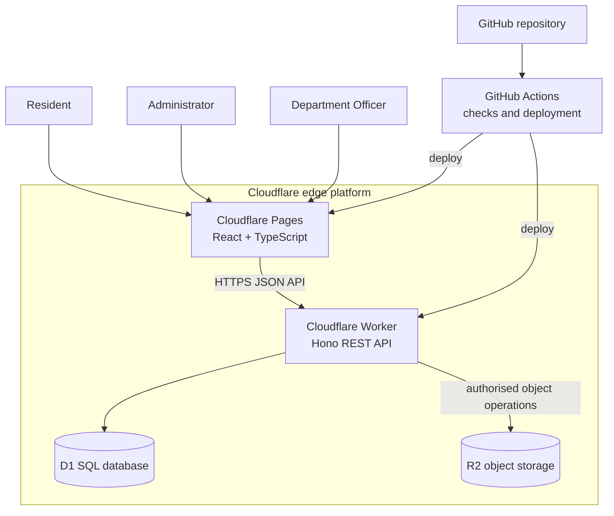

# Kedah Community Connect — Architecture and Design Decisions

## 1. Architecture style

Use a **serverless modular monolith** for the first release.

The frontend is a separate static web application. A single Hono API Worker contains modular route groups and service layers. D1 stores structured relational data. R2 stores uploaded objects. This keeps deployment simple while preserving boundaries that can later be separated if there is a demonstrated need.

Do not start with microservices, Kubernetes, or a message broker. They add operational complexity without being necessary for the MVP.

## 2. Logical architecture

## 3. Request flow: create a report

1. Resident signs in.
2. Frontend submits report data to `POST /api/v1/reports`.
3. Worker validates session and request schema.
4. Worker checks that the authenticated account has `RESIDENT` role.
5. Worker validates category, title, description, and optional coordinates.
6. Worker inserts the report and initial status-history record.
7. Worker returns the report reference and current status.
8. Frontend displays the report detail page.

## 4. Request flow: upload an image

1. User selects an image.
2. Frontend requests upload authorisation for a report.
3. Worker checks report ownership or staff permission.
4. Worker validates size, file type, and allowed attachment count.
5. Worker creates a random object key.
6. Upload occurs through a controlled R2 flow.
7. Worker records attachment metadata in D1.
8. A later download request is authorised before serving the object.

Private report images must not be exposed through predictable public URLs.

## 5. Request flow: assign and resolve

1. Administrator opens a report.
2. Administrator selects a department and, optionally, an officer.
3. Worker checks `ADMIN` permission and validates the target department/officer.
4. Worker updates assignment and status history transactionally.
5. Department officer sees the report in their authorised work queue.
6. Officer records progress and eventually a resolution summary.
7. Worker validates the workflow transition and writes history.
8. Resident sees public status updates, not internal notes.

## 6. Application layers

### Frontend
- Pages: route-level screens.
- Components: reusable UI elements.
- Features: reports, authentication, administration, department work, notifications.
- API client: typed wrappers for HTTP requests.
- Auth state: current user and session status.
- Form schemas: shared validation where suitable, with server validation remaining authoritative.

### Worker API
- Routes: HTTP request/response mapping.
- Middleware: request ID, authentication, role checks, error handling.
- Schemas: Zod validation.
- Services: business rules and workflows.
- Repositories: database queries.
- Storage adapter: R2 operations.
- Domain types: roles, statuses, entities, and permission policies.

### Data layer
- D1 tables for structured data.
- R2 buckets for images.
- SQL migrations committed to the repository.
- Indexes for frequently filtered data.

## 7. Environment and bindings

Use separate local and production configuration. Expected Worker bindings include:
- `DB` — D1 database binding.
- `REPORT_FILES` — R2 bucket binding.
- `APP_ENV` — environment name.
- Authentication/session secrets — set as runtime secrets, never committed.

Use Wrangler's current configuration format and commands. Verify syntax against current Cloudflare documentation rather than copying old examples.

## 8. Authentication design decision

For a learning MVP, application-managed authentication can demonstrate password hashing, session lifecycle, and RBAC. This is security-sensitive. Use a well-maintained library compatible with the Workers runtime; do not invent cryptography.

Prefer secure, HttpOnly, SameSite cookies for a browser application. If cookie sessions are used, implement CSRF protection for state-changing requests. If signed tokens are used, define short expiry, refresh/revocation strategy, and secure storage. Never store long-lived secrets in browser local storage.

Before real public use, consider a mature managed identity provider and conduct a security review.

## 9. Database decision

D1 is SQLite-compatible, not PostgreSQL. Keep SQL and data-access code behind a repository layer so the domain logic is not tightly coupled to D1. Use parameterised statements, migrations, indexes, and transactions where supported.

For a portfolio-scale MVP, D1 is appropriate. If the project later requires advanced relational capabilities, concurrency patterns, or a different hosting environment, evaluate PostgreSQL and document the migration trade-offs.

## 10. Event-driven extensions

Do not add a queue in the first milestone. Initially, create in-app notifications in the same application workflow where practical.

Later, if asynchronous work is justified, evaluate Cloudflare Queues or another supported service for:
- Notification delivery
- Image processing
- Analytics aggregation
- Retryable background tasks

Confirm current free quotas and limits before adoption. A queue is not required to claim that the MVP is cloud-native.

## 11. Reliability and observability

- Generate a request ID for every API request.
- Emit structured logs with request ID, route, outcome, and duration.
- Redact secrets and personal data from logs.
- Return stable error codes.
- Handle database and storage errors gracefully.
- Track failed requests and latency using platform-provided tools within available plan limits.
- Add health/readiness endpoints that do not disclose sensitive configuration.
- Document backup/export and recovery limitations of the selected free plan.

## 12. Cost-control design

- Start locally.
- Use only services with a suitable free allowance.
- Avoid paid add-ons and custom domains initially.
- Limit uploaded file size and count.
- Use pagination and indexes to reduce database work.
- Avoid unnecessary polling.
- Review usage and current pricing before each deployment milestone.
- Do not claim the deployment is free without checking the current account plan and actual usage.
